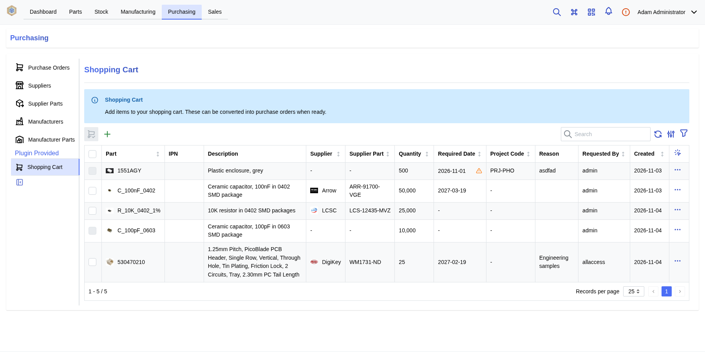
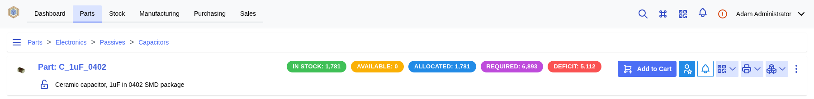
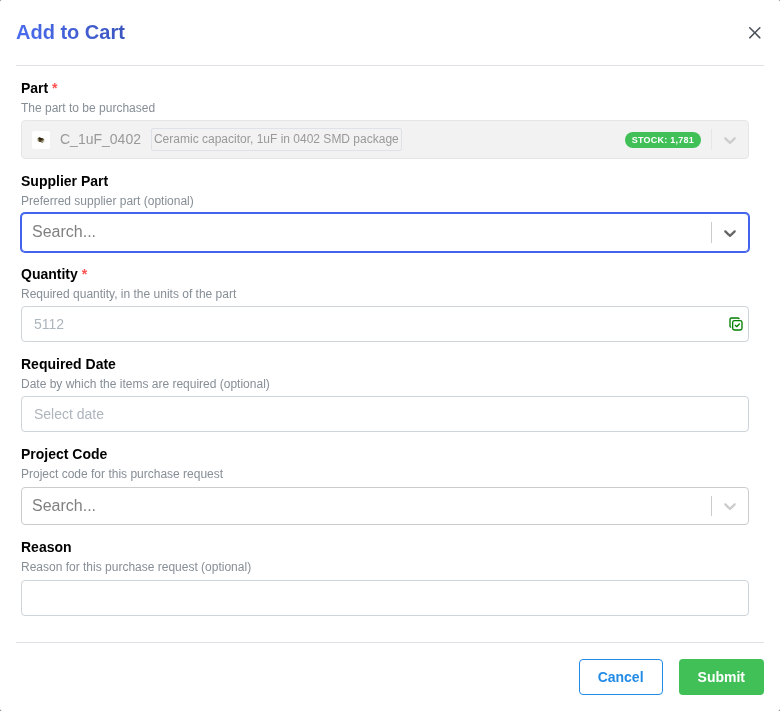
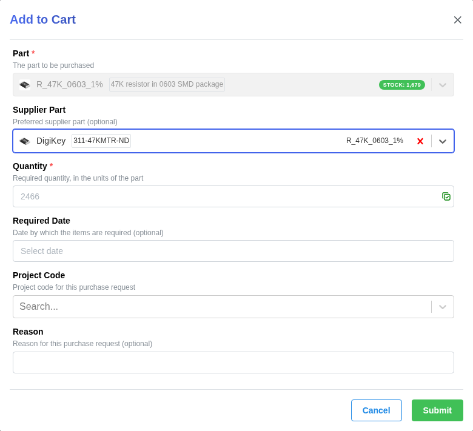
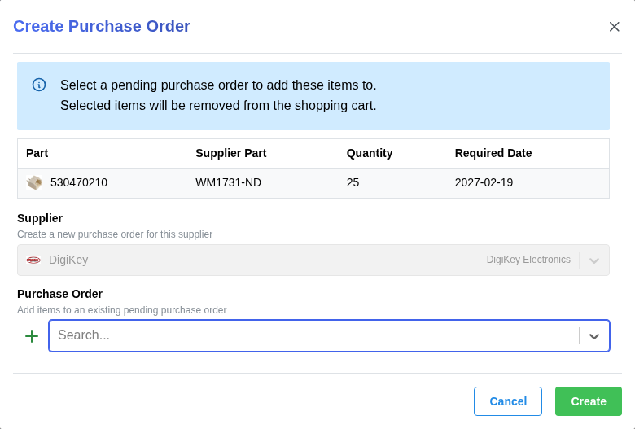

[](https://opensource.org/licenses/MIT)
[](https://pypi.org/project/inventree-shopping-cart/)


# ShoppingCart

Collect purchase requests in a shopping cart, and consolidate them into purchase orders.

Users add *purchase requests* for parts they need to a shared shopping cart. A purchasing officer later reviews the cart, selects multiple requests, and converts them into a purchase order in a single step.

## Installation

### InvenTree Plugin Manager

Install the `inventree-shopping-cart` package from the InvenTree plugin manager, then activate the *Shopping Cart* plugin.

### Command Line

To install manually via the command line, run the following command:

```bash
pip install inventree-shopping-cart
```

## Configuration

This plugin requires InvenTree 1.7.0 or newer, and the following global settings must be enabled:

- **Enable app integration**: The plugin provides a database table, so migrations must be run after activation.
- **Enable URL integration**: The plugin provides custom API endpoints.
- **Enable interface integration**: The plugin provides a custom UI panel.

## Usage

The *Shopping Cart* panel is displayed on the **Purchasing** page.



### Requesting Items

Any user with *view* permission for purchase orders can add items to the cart. Each request records:

| Field | Description |
| --- | --- |
| Part | The (purchaseable) part to be purchased |
| Supplier Part | Preferred supplier part (optional) |
| Quantity | Required quantity, in the units of the part |
| Required Date | Date by which the items are needed (optional) |
| Reason | Reason for the purchase (optional) |
| Project Code | Project code for the purchase (optional) |
| Destination | Stock location where the received items should be placed (optional) |
| User | The user who made the request (assigned automatically) |

Items can also be added using the **Add to Cart** button in the page header, on the detail page of any active, purchaseable part, or of an active supplier part for a purchaseable part. When added from a supplier part page, the supplier part is pre-selected.



The required quantity is suggested based on the existing requirements for the part (see [API](#api)). The suggested quantity is displayed as a placeholder, and can be auto-filled by clicking on the button next to the quantity field.

| Added from a part page | Added from a supplier part page |
| --- | --- |
|  |  |

The **Shopping Cart** dashboard item can be added to the InvenTree dashboard. It displays the number of items in the cart, and links to the shopping cart panel.


Users can edit or remove their own requests. Users with *change* or *delete* permission for purchase orders can edit or remove any request.

### Creating Purchase Orders

Users with *add* permission for purchase orders can select multiple requests in the cart, and create a purchase order from them. Only requests which specify a supplier part can be selected, and all selected requests must be from the same supplier (the supplier is determined from the selected requests). Then either:

- Leave the purchase order empty, to create a new purchase order for the supplier, or
- Select an existing **pending** purchase order for the supplier, to add the items to it, or
- Create a new purchase order directly from the form (using the **+** button next to the purchase order field), to customize the new order



For each selected request, a supplier part is determined as follows:

1. If the request specifies a supplier part, it must be from the selected supplier
2. Otherwise, the default supplier part for the part is used (if it is from the selected supplier)
3. Otherwise, the part must have exactly one active supplier part from the selected supplier

If a supplier part cannot be determined for any selected request, no changes are made.

Each request becomes a separate line item. The requested quantity is converted to supplier pack quantity (rounded up to whole packs), and the required date, project code, destination and reason are copied to the line item. If all of the selected requests share a single project code (or destination), it is also assigned to a newly created purchase order.

Converted requests are removed from the cart.

## API

| Endpoint | Description |
| --- | --- |
| `/plugin/shopping-cart/cart/` | List and create cart entries |
| `/plugin/shopping-cart/cart/<pk>/` | Retrieve, update or delete a cart entry |
| `/plugin/shopping-cart/cart/convert/` | Convert cart entries into a purchase order |
| `/plugin/shopping-cart/cart/requirements/<part>/` | Suggested purchase quantity for a part (requires `part` view permission) |

The list endpoint supports the following filters: `part`, `supplier_part`, `project_code`, `user`, `mine`, `has_supplier_part`, `supplier` and `overdue`.

The suggested quantity is the shortfall between the quantity required (open build orders, open sales orders and the part's minimum stock level) and the quantity available (total stock, quantity on order, and quantity already in the cart).

## Development

Run the unit tests from the InvenTree backend directory:

```bash
INVENTREE_PLUGIN_TESTING=True INVENTREE_PLUGIN_TESTING_SETUP=True python manage.py test shopping_cart
```
